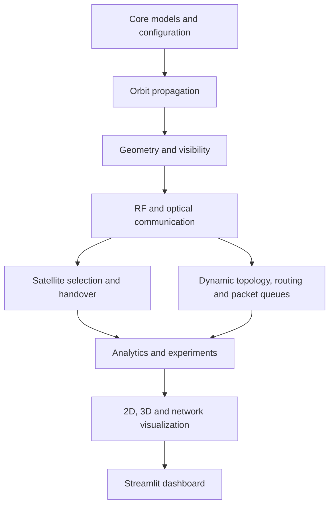

# ORBITLINK architecture

The engine layers remain independent of Streamlit so batch runs, tests and the dashboard use the same physics and network logic. Configuration and assumed link parameters are kept visible to experiments.
